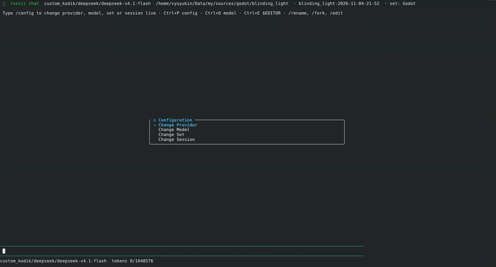
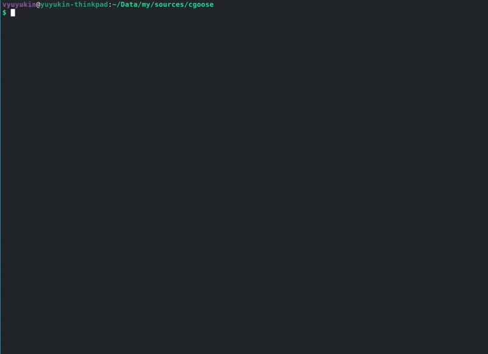
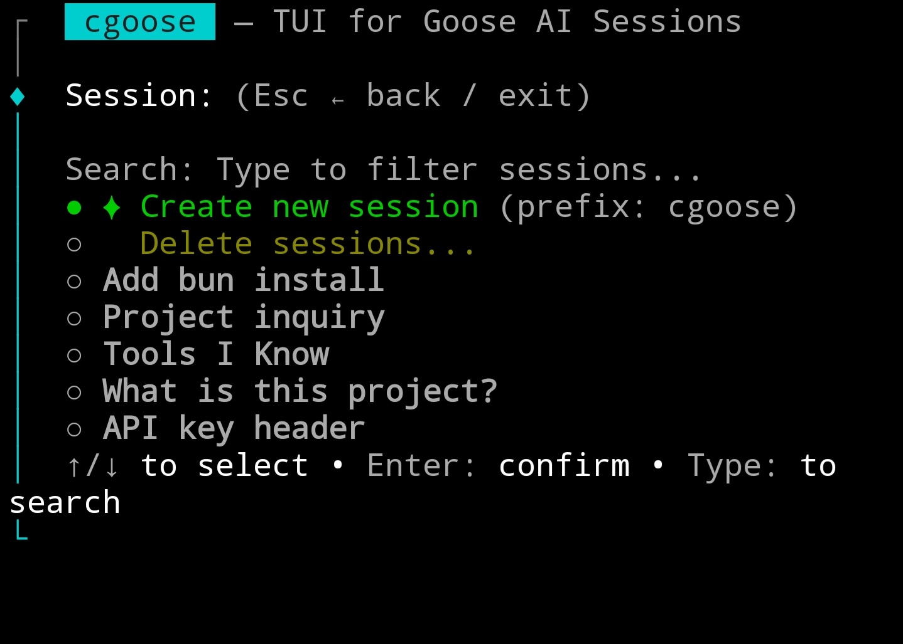
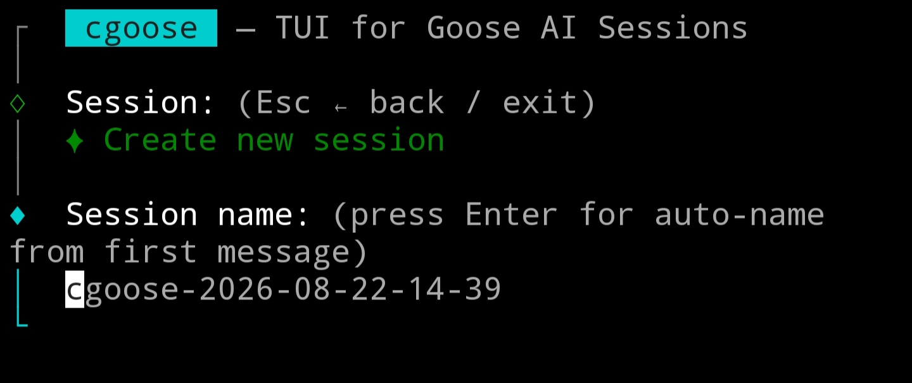
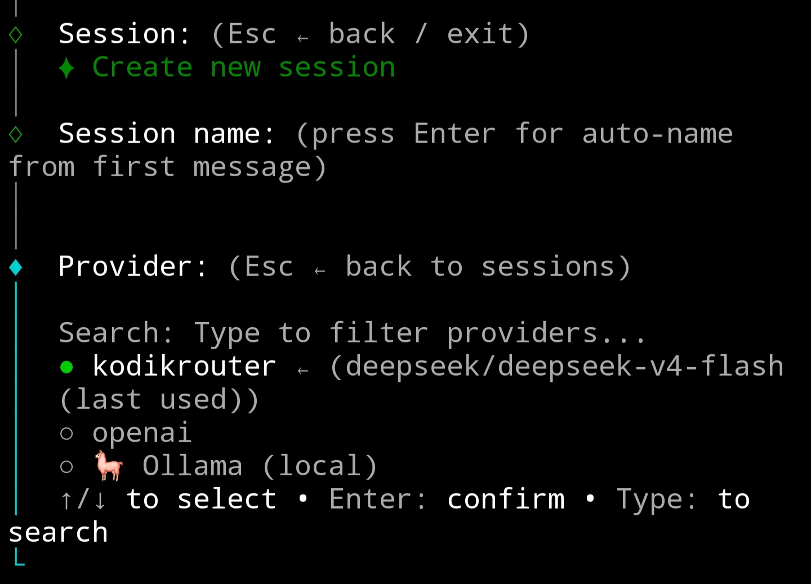
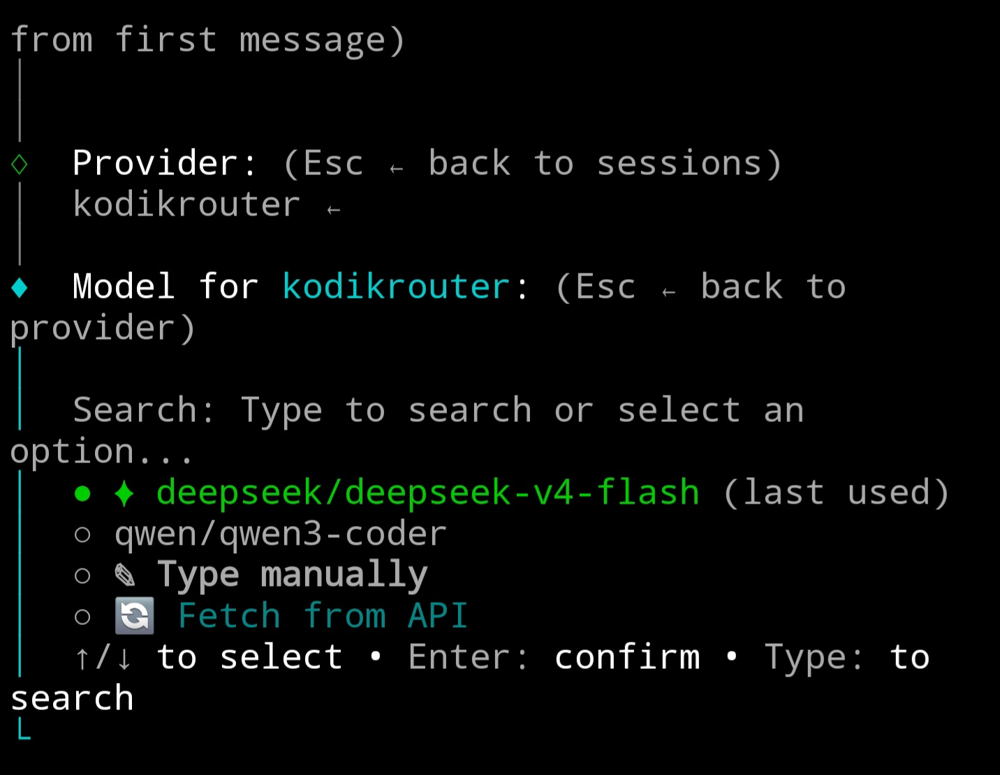

# rossii — an ACP terminal UI for Goose

**rossii** is a full terminal user interface for [Goose](https://github.com/block/goose). It speaks
the **Agent Client Protocol (ACP)** to `goose acp` and renders the conversation itself — streaming
answers, thinking, tool calls, permission prompts, tokens and cost — while keeping the workflow
around it: per-project memory, session sets, worktrees, provider/model switching and model
discovery.

It is not a wrapper that types `goose session` for you anymore. The chat *is* rossii; the classic
Goose TUI is an opt-in fallback (`ROSSII_ACP_MODE=classic`).

> **⚠ Tested only on Linux.** May work on macOS (no `secret-tool`, file-based secrets work). Windows is not supported.
>
> Requires a Goose build with the `acp` subcommand — verified on **1.50.0** and **1.57.0**.

> **Renamed in 3.0.0.** The project was called **cgoose** up to 2.4.0 — *Anser rossii*, Ross's goose, is
> the smallest goose there is (the old name and docs are kept in [`docs/legacy-classic.md`](docs/legacy-classic.md)).
> Settings are read from `~/.config/rossii`, falling back to the old `~/.config/cgoose`, and the
> `ROSSII_*` environment variables still honour their `CGOOSE_*` spellings.

---

## Demo — the chat



Live configuration from inside the running chat — the `/config` dialog, the model list with its
context limits (here **Fetch models from API** pulled 712 models from the provider), and a prompt
answered without leaving the session.

---

## Demo — the wizard



The wizard is still there — it collects the session, set, provider and model — but it now opens
straight into rossii's own chat.

---

## Screenshots

| Session list | New session |
|:--:|:--:|
|  |  |
| Provider selection | Model selection |
|  |  |

---

## Why rossii?

Goose's CLI works, but every session raises the same questions: which provider did I use in this
project, with which model, under which name, with which system prompt and extensions? And once the
session is running, changing any of that means restarting it.

**rossii remembers** — and lets you change the answer *while the session runs*:

- per-project history of sessions, providers, models and sets;
- a chat UI built for long turns: streaming, tool calls, permissions, scrollback, watchdogs;
- live reconfiguration — switch provider, model, session set or session without losing the conversation;
- the same Goose data (`config.yaml`, `custom_providers/`, `sessions.db`), so `goose` and rossii see
  the same sessions.

---

## Installation

### Option 1: One-liner — the latest release (no runtime needed)

```bash
curl -fsSL https://raw.githubusercontent.com/viorn/rossii/main/install-release.sh | sh
```

Fetches the newest GitHub release, checks its SHA-256 and installs the binary to
`~/.local/bin/rossii`. Pin a tag or a target directory with
`sh -s -- --version v3.2.0 --dir /usr/local/bin`; `--help` shows the rest.

### Option 2: Standalone binary (no runtime needed)

```bash
bash build.sh
./rossii
```

Requires **Bun** to build; the resulting binary runs on any Linux x86_64 without Bun.

### Option 3: Local install (requires Bun)

```bash
bash install.sh
rossii
```

Installs source + deps to `~/.local/lib/rossii/` and a launcher to `~/.local/bin/rossii`
(make sure `~/.local/bin` is in `PATH`).

### Option 4: Run from source (requires Bun)

```bash
bun install
bun start
```

---

## The chat

rossii spawns `goose acp` and drives it as an ACP client. One command resumes a session, picks the
set/provider/model from the project's history, and keeps everything changeable from inside the chat.

- **Streaming** — assistant text is rendered as it arrives under an `❮ Answer · N chars`
  label that counts the characters received so far, the thinking block that is streaming is
  expanded (and collapses to a `💭 Thought · N chars` bar once the answer starts), so reasoning is
  visible live but stays out of the way afterwards; a left click (or `/think`) opens it again. Tool
  calls and their results are printed inline, and the status bar tracks the current set, context
  usage, tokens and cost.
- **Its own screen** — the chat owns the alternate screen and scrolls the transcript itself
  (mouse wheel, PgUp/PgDn, Ctrl+Shift+F to search) while the composer stays pinned at the bottom.
  Streaming never yanks the view back. On exit the transcript is printed to the normal screen, so
  it stays in your scrollback. `ROSSII_CHAT_MAIN_SCREEN=1` restores the inline renderer.
- **Permissions** — `session/request_permission` requests appear as framed dialogs (queued when
  several tool calls ask at once); Esc or Ctrl+C rejects them. During a turn Esc/Ctrl+C cancels it.
- **History** — resuming replays the conversation into the chat; sessions are read straight from
  `sessions.db`, so sessions created by `goose` itself are listed too.
- **Watchdogs** — a silent agent (no update for 5 minutes) is cancelled, and one turn is capped at
  4 hours. Both are configurable, both can be disabled.

### Slash commands

Type them into the composer:

| Command | What it does |
|---------|--------------|
| `/config` | Menu: provider, model, set, session |
| `/provider [name]` | Switch provider (applied to the running session) |
| `/model [name\|fetch]` | Switch model, or fetch the provider's model list from its API |
| `/set [name\|default\|none]` | Switch the session set — system prompt **and** extensions, live |
| `/session` | Switch session, start a new one, rename, fork |
| `/session rename <title>` · `/rename [title]` | Rename (bare command asks in the composer) |
| `/fork` | Copy the conversation into a new session |
| `/edit` | Write the prompt in `$VISUAL`/`$EDITOR` — it is sent when the editor closes |
| `/think [expand\|collapse] [all]` | Expand/collapse thinking blocks (bare `/think` toggles the last one) |
| `/settings` (alias of `/config`) | Same menu as `/config` |

### Keyboard shortcuts

| Key | Opens |
|-----|-------|
| `Ctrl+P` | the configuration menu (`/config`) |
| `Ctrl+O` | the model menu (`/model`) |
| `Ctrl+E` | the external editor (`/edit`) |

`Ctrl+M` cannot be bound to the model menu: a terminal sends Enter as CR, which *is* Ctrl+M, so the
shortcut would fire every time you submit a prompt. `Ctrl+O` is the free equivalent.

`/edit` hands the terminal to `$VISUAL` (then `$EDITOR`, then `vi`) with the composer's draft as the
buffer, and sends whatever it finds when the editor exits cleanly — Esc out of the editor instead and
nothing is sent, the draft stays. The chat takes the alternate screen back afterwards.

Everything a command does is also reachable from the menus, and a set change, session switch or
fork is refused while a turn is running (provider/model switches are allowed and apply to the next
turn). Every menu — provider, model, set, session, `/config` itself — carries a filter line: type to
narrow the list by **substring** (`flash` finds `deepseek-v4-flash`), Backspace widens it again, and
the arrows, Enter and Esc keep behaving exactly as before.

### Changing things live

- **provider / model** → `session/set_config_option`, provider first, because switching the provider
  resets the model to that provider's default. Works on new *and* resumed sessions.
- **set** → the set's system prompt plus the extension list, reconciled in place through
  `_goose/unstable/session/extensions/{list,add,remove}`. Switching to `Default` rebuilds the
  profile from `config.yaml` (goose has no "reset to profile" request), `None` empties the list.
- **session** → `session/load` replays history, then the current provider/model pair is re-applied and
  the set is reconciled, so every session in a project ends up with the configuration shown in the
  header. The picker only lists sessions of this project's directories.
- **rename / fork** → `_goose/unstable/session/rename` and `session/fork`; the fork is renamed
  `<title> (fork)` and configured like its parent.

Config values also move: the model list comes from `configOptions` goose reports, and when the
provider knows more models than goose does, **🔄 Fetch models from API** calls the provider's own
`GET {base_url}/v1/models` and offers the result in a searchable list. Picking a model that the
provider's JSON does not list records it there with the API's context limit, so the wizard sees it
too.

---

## Session sets

A **session set** is a YAML file at `~/.config/rossii/sets/<name>.yaml` that bundles a system
prompt and the extensions a session should have:

```yaml
title: My Set
systemPrompt: You are an expert in...
builtins: [developer, analyze, memory]                # bundled Goose builtins
extensions: [fetch]                                   # names from ~/.config/goose/config.yaml
stdioExtensions: ["mcpls --trust-project-config"]     # ad-hoc stdio commands
```

- `systemPrompt` → the agent's system prompt for the session.
- `builtins` → `--with-builtin` (and `{type:"builtin"}` entries in chat mode).
- `extensions` → names of extensions already configured in `~/.config/goose/config.yaml`
  (`fetch`, `mcpls`, `sigma`, …). `builtin`/`platform` become builtins, `stdio` becomes an MCP
  server with its resolved command and env, `streamable_http` becomes an HTTP MCP server.
- `stdioExtensions` → raw `[name:]command args` lines, run as stdio MCP servers.
- Sets are discoverable, creatable, editable and deletable from the wizard, and can be switched
  live from the chat.

#### None vs Default vs a set

| Choice | Result |
|--------|--------|
| **None** | A session with no extensions at all (`--no-profile` in classic mode, an empty `enabledExtensions` list in chat mode). Some Goose builds add their own `developer`; rossii tolerates it and never adds or removes it. |
| **Default** | Leave the profile alone — every extension enabled in `~/.config/goose/config.yaml` loads. |
| **&lt;set&gt;** | Exactly what the set lists, nothing else. |

The selected set is the **source of truth** for the system prompt: on resume the *current* set's
prompt is applied, and "None" explicitly clears any prompt stored in the session DB (Goose ≥ 1.55
persists it) instead of restoring the old one. Editing a set and resuming is enough to pick up the
change — there is no per-project snapshot.

**Why not recipes?** Recipes run through `goose run --recipe`, which creates a one-shot session with
no resume. Installed recipes are still discovered (`goose recipe list --format json`) and shown in
the wizard, but a set is what rossii launches.

---

## The wizard

Six steps, always seeded with the last answer in this project:

1. **session** — pick an existing session or create a new one
2. **session name** — type one, or press Enter for an auto-generated name
3. **set** — last used first (`❶`), then None, then history and the rest, plus create/manage sets
4. **provider** — history first, then alphabetical (`custom_*` providers only when their JSON exists)
5. **model** — last used (`✦`), history, configured models, manual input or fetch from the API
6. **launch** — summary and confirmation

**Pressing Enter on every step resumes with exactly the set, provider and model you used last** —
which makes the wizard a two-key affair in practice. Esc goes back one step.

Provider, model and set are remembered **per directory**, and everything else follows from that:
the quick modes and the live switcher reuse the same history.

---

## Quick modes

| Flag | What it does |
|------|--------------|
| `a` | Auto-resume the last session of this directory |
| `n` | New session with the last provider, model and set |
| `s` | Session picker only, then launch with the last provider/model/set |
| `m` / `w` | Without / with git worktree isolation |
| `ma` `ms` `mn` | The above, without worktrees |
| `wa` `ws` `wn` | The above, with worktrees forced on |
| `e` / `me` / `we` | Edit mode: roll a session back to an earlier message |

`a` and `n` skip the wizard entirely; in chat mode they also skip the confirmation, so the chat
opens immediately. In classic mode the "Launch Goose now?" prompt stays.

```bash
rossii a            # resume the last session here, chat opens right away
rossii n            # new session, chat opens right away
rossii s            # pick a session, then launch
rossii wa           # auto-resume with a git worktree

ROSSII_ACP_MODE=classic rossii n   # hand the terminal to the classic `goose session` TUI
```

---

## Providers, models, secrets

- Providers come from `~/.config/goose/config.yaml`; `custom_*` providers are read from
  `~/.config/goose/custom_providers/*.json` (engine, base URL, model list, context limits).
- Model lists come from Goose (`configOptions`) or from the provider's own `GET /v1/models`, with
  `context_limit` / `context_window` / `max_tokens` parsed when the API reports one. A model added
  from the chat is written back to the provider JSON with that limit and exported as
  `GOOSE_CONTEXT_LIMIT` for the session.
- **Ollama** is detected when it is running locally; models are listed with a tool-calling badge.
- API keys are read from the system keyring (libsecret), `~/.config/goose/secrets.yaml` and the
  environment. A missing key produces a hint naming the variable to set.
- `.goose/config.yaml` in the project (or the session's worktree) is loaded through
  `GOOSE_ADDITIONAL_CONFIG_FILES`, and `${VAR}` / `$VAR` references in it are resolved from Goose's
  secrets before the session starts.

---

## Git worktrees

New sessions can run in a dedicated worktree at `<repo>/.worktree/<name>` on a matching branch:

- resume detects the existing worktree and continues there;
- deleting a session removes the worktree and the branch;
- stale registrations are pruned automatically;
- disabled outside a git repo, enabled per run with `w`/`wa`/`ws`/`wn`, or permanently with
  `{ "default_mode": "worktree" }` in `~/.config/rossii/config.json`.

---

## Requirements and compatibility

- **Goose** with the `acp` subcommand. Without it, rossii prints a warning and falls back to the
  classic `goose session` TUI.
- The `_goose/unstable/*` requests rossii uses (system prompt, extension add/remove/list, rename)
  degrade into chat warnings on builds that lack them, so an older Goose still works with the
  features it has.
- **Bun** ≥ 1.x to run from source or build the binary.
- Linux; macOS may work; Windows is unsupported.

---

## Environment variables

| Variable | Default | Meaning |
|----------|---------|---------|
| `ROSSII_ACP_MODE` | `acp` | `classic` hands the terminal to `goose session` instead of rossii's chat |
| `ROSSII_ACP_IDLE_TIMEOUT_MS` | `300000` | cancel a turn when the agent sends nothing for this long (`0` disables) |
| `ROSSII_ACP_PROMPT_TIMEOUT_MS` | `14400000` | absolute cap on a single turn (`0` disables) |
| `ROSSII_CHAT_MAIN_SCREEN` | unset | `1` renders the chat inline instead of on the alternate screen |
| `ROSSII_NO_WORKTREE` | set by default | `1` skips worktree creation |
| `ROSSII_FORCE_WORKTREE` | unset | `1` forces worktrees (overrides the above) |
| `ROSSII_DEBUG` | unset | `1` echoes `goose acp` stderr and the launch command |
| `GOOSE_PATH_ROOT` | `~/.local/share/goose` | where rossii looks for `sessions/sessions.db` (Goose honours the same variable) |

---

## How it works

```
rossii (Bun + pi-tui) ── stdio JSON-RPC 2.0 ──> goose acp
        │                                           │
        │  initialize / session/new | session/load   │
        │  session/prompt ⇄ session/update           │
        │  session/set_config_option                 │
        │  _goose/unstable/…  (goose extensions)     │
```

| Path | Role |
|------|------|
| `src/acp/client.ts` | ACP transport: spawn, JSON-RPC framing, request timeouts, agent→client handlers |
| `src/acp/chat.ts` | the chat UI: transcript, composer, overlays, slash commands, watchdogs |
| `src/acp/custom.ts` | Goose's custom `_goose/unstable/*` requests |
| `src/acp/extensions.ts` | session set → ACP extension list (`planGooseExtensions`, `planProfileExtensions`, diffing) |
| `src/acp/session-config.ts` | provider/model through `session/set_config_option` |
| `src/acp/session-meta.ts` | `session/new` `_meta` (session title, client identity, extension list) |
| `src/acp/overlay.ts` | framed and searchable overlay components |
| `src/acp/timeouts.ts` | turn watchdogs |
| `src/launcher.ts` | shared launch preparation (worktree, env, secrets) and the classic mode |
| `src/index.ts` | CLI flags and the setup wizard |

### Development

```bash
bun run check     # tsc
bun run test      # unit tests: extensions, session meta/config, sessions db, client, overlays
bun run acp:probe # raw ACP session against a real goose
bun run acp:smoke # AcpClient without the TUI
```

The probe scripts under `scripts/acp-*-probe.ts` (config options, config surface, fork) need a real
`goose acp` but no API key — they never send a prompt.

| Script | What it does |
|--------|--------------|
| `build.sh` | compiles a standalone binary (`./rossii`) with the Bun runtime embedded |
| `install.sh` | installs source to `~/.local/lib/rossii/` and a launcher to `~/.local/bin/rossii` |
| `install-release.sh` | installs the latest release binary to `~/.local/bin/rossii` — what the curl one-liner runs |

Two UI toolkits meet here: the chat renders with [pi-tui](https://github.com/earendil-works/pi-tui),
the setup wizard still uses [Clack](https://github.com/natemoo-re/clack) prompts.

---

## Data locations

| What | Where |
|------|-------|
| Goose config | `~/.config/goose/config.yaml` |
| Custom providers | `~/.config/goose/custom_providers/*.json` |
| Secrets | system keyring · `~/.config/goose/secrets.yaml` · environment |
| Sessions (both UIs) | `~/.local/share/goose/sessions/sessions.db` |
| Session sets | `~/.config/rossii/sets/*.yaml` (legacy `.json` still read) |
| Per-project memory | `~/.config/rossii/projects/<dir>-<hash>.json` |
| rossii config | `~/.config/rossii/config.json` |
| Git worktrees | `<repo>/.worktree/<name>` |

---

## Legacy: before the ACP renderer

Up to v2.2 rossii was a Clack wizard that prepared the flags and launched `goose session` — the
setup workflow, with Goose's own TUI doing the talking. That description is kept for history,
including a comparison of what it could and could not do:

- [docs/legacy-classic.md](docs/legacy-classic.md) — archived README (English)
- [docs/legacy-classic.ru.md](docs/legacy-classic.ru.md) — архивный README (по-русски)

The classic path still exists in the code: `ROSSII_ACP_MODE=classic` hands the terminal to
`goose session` with the same session sets, worktrees and per-project history.

---

## License

MIT
