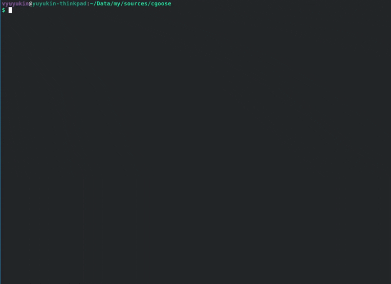
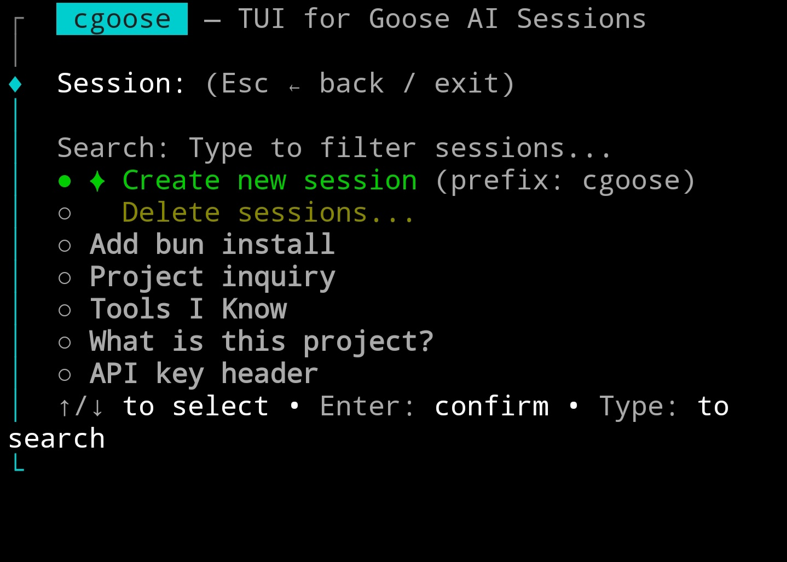
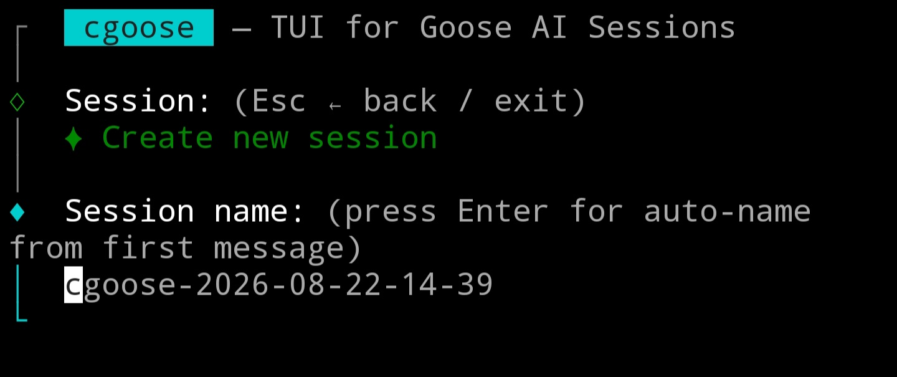
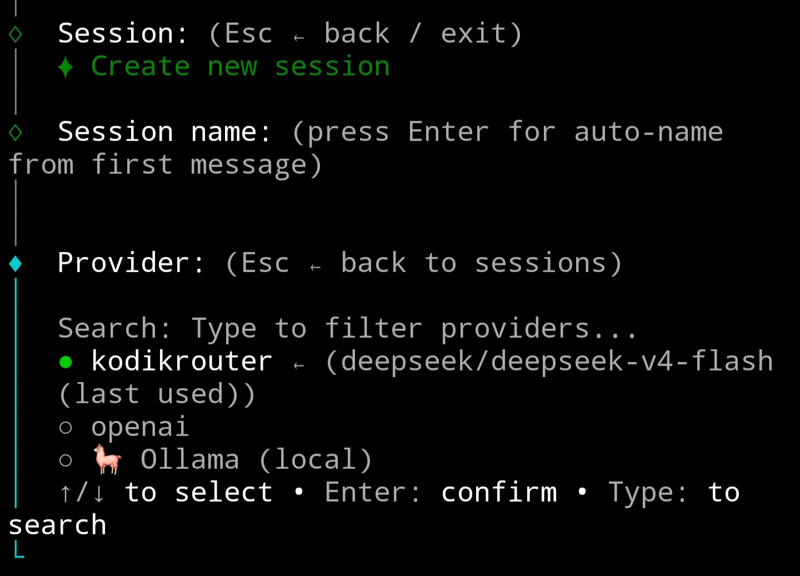
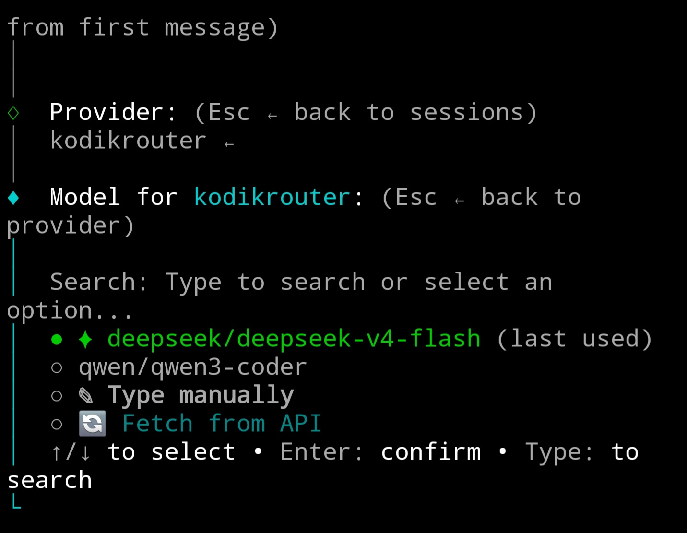

# cgoose — TUI для Goose AI сессий

**cgoose** — терминальный интерфейс для [Goose](https://github.com/block/goose) — вашего ИИ-агента для кодинга. Он заменяет сырые CLI команды интерактивным пошаговым workflow для выбора сессий, провайдеров, моделей и **session set'ов** (наборов из системного промпта + встроенных расширений).

> Сделан на [Clack](https://github.com/natemoo-re/clack) prompts + [picocolors](https://github.com/alexeyraspopov/picocolors), работает на [Bun](https://bun.sh).
>
> **⚠ Протестировано только на Linux.** Может работать на macOS (secret-tool недоступен, но file-based секреты работать должны). Windows не поддерживается.

---

## Демо



---

## Скриншоты

| Список сессий | Новая сессия |
|:--:|:--:|
|  |  |
| Выбор провайдера | Выбор модели |
|  |  |

---

## Зачем cgoose?

CLI Goose работает, но каждый раз при старте сессии нужно помнить:

- Какой провайдер я использовал в прошлый раз в этом проекте?
- Какая модель?
- Какое имя сессии?
- Какой системный промпт / расширения?

**cgoose запоминает.** Он хранит историю провайдеров, моделей и session set'ов по каждому проекту, показывает что вы использовали в последний раз и позволяет получать модели прямо из API, вместо ручного ввода.

---

## Установка

### Вариант 1: Standalone бинарник (не требует рантайма)

```bash
bash build.sh
./cgoose
```

Требует **Bun** только для сборки, но готовый бинарник запускается на любом Linux x86_64 без Bun.

### Вариант 2: Локальная установка (требует Bun)

```bash
bash install.sh
cgoose
```

Ставит исходники + зависимости в `~/.local/lib/cgoose/` и лаунчер в `~/.local/bin/cgoose`. Убедитесь, что `~/.local/bin` в вашем `PATH`.

### Вариант 3: Запуск из исходников (требует Bun)

```bash
bun install
bun start
```

---

## Возможности

### Управление сессиями
- **Список сессий** для текущей рабочей директории с fuzzy-поиском
- **Создание новой** — своё имя или пустое для авто-имени из первого сообщения
- **Возобновление** существующих сессий с полной историей
- **Пакетное удаление** — выбор по одной или очистка всех сессий для текущей директории

### Session Set'ы (замена рецептов)
**Session set** — YAML-файл в `~/.config/cgoose/sets/<name>.yaml`, объединяющий:

```yaml
title: My Set
systemPrompt: You are an expert in...
builtins: [developer, analyze, memory]                # встроенные builtins Goose
extensions: [fetch]                                   # расширения из ~/.config/goose/config.yaml
stdioExtensions: ["mcpls --trust-project-config"]     # произвольные stdio-команды
```

- **Системный промпт** передаётся через флаг `--system` (добавляется к дефолтному промпту Goose)
- **builtins** передаются через `--with-builtin`
- **extensions** — имена расширений, уже настроенных в `~/.config/goose/config.yaml` (например `fetch`, `mcpls`, `sigma`). Каждая запись транслируется в нужный флаг: `builtin`/`platform` → `--with-builtin`, `stdio` → `--with-extension "name:cmd args"`, `streamable_http` → `--with-streamable-http-extension <uri>`
- **stdioExtensions** — готовые командные строки, передаются напрямую в `--with-extension`
- Сеты запускаются с `--no-profile`: загружается **только** то, что перечислено в сете (в chat-режиме то же самое даёт `_meta.enabledExtensions` — пустой массив означает «без расширений»)
- Создаёт **консистентные, воспроизводимые** конфигурации агентов — без сложности recipe YAML
- Session set'ы всегда запускаются через `goose session`, что даёт историю сессий, resume и fork
- Set'ы можно создавать, редактировать и удалять через TUI

#### Выбор сета: None vs Default vs сет
- **None** — вообще без расширений (`--no-profile` и больше ничего): голый агент без shell/файловых инструментов (в chat-режиме на goose 1.50/1.57 расширений не остаётся вообще; некоторые сборки добавляют свой `developer` — cgoose это терпит)
- **Default** — не трогаем профиль: Goose грузит все включённые расширения из `~/.config/goose/config.yaml` (классическое поведение `goose session`)
- **&lt;сет&gt;** — ровно те builtins/расширения, что перечислены в сете

Флаги расширений применяются только при **создании** сессии. При resume Goose восстанавливает набор расширений, сохранённый в БД сессии, и игнорирует флаги расширений — побеждает то, с чем сессия создавалась (системный промпт сета при этом всё равно применяется заново). В chat-режиме набор сета применяется и к возобновляемой сессии (загруженный список сравнивается и приводится к сету через `_goose/unstable/session/extensions/*`), кроме сетов со stdio-расширениями, у которых есть inline-переменные `KEY=value`: goose принимает env только через `envKeys` со ссылкой на своё хранилище секретов, поэтому такой сет откатывается к режиму «профиль тоже загружается».

#### Промпт при resume
Выбранный set — источник истины для системного промпта. Goose ≥ 1.55 хранит `--system` в БД сессии (`system_prompt_extras`), поэтому при resume применяется промпт **текущего** set'а (изменил set → resume → свежий промпт). Если set не выбран, передаётся явный `--system ""`, чтобы очистить ранее сохранённый промпт — без этого флага старое значение вернётся.

**Почему не рецепты?**
- Рецепты используют `goose run --recipe`, который создаёт одноразовую сессию без возможности resume
- Рецепты требуют YAML-синтаксис с sub-recipes, параметрами, response schema — избыточно для большинства случаев
- Session set'ы — это простой JSON, легко редактируется и работает с `goose session` (полная история/resume/fork)

TUI по-прежнему находит установленные рецепты через `goose recipe list --format json`, но показывает их как read-only в отдельной секции, а запуск рецепта создаёт эквивалентный session set.

### Выбор провайдера
- Сортировка по вашей истории использования (сначала последние), затем по алфавиту
- Показывает последний использованный, историю и подсказки провайдера сессии
- **Ollama** — автоопределение при локальном запуске, показывает количество моделей + поддержку инструментов
- Поддержка любого числа включённых провайдеров из конфига Goose
- Кастомные провайдеры (`custom_*`) показываются только при наличии JSON-конфига

### Выбор модели
- **Последняя использованная модель** показана по умолчанию (`✦`)
- **История моделей** по провайдеру — ранее использованные под рукой
- **Fetch из API** — запрос `GET /v1/models` на OpenAI-совместимых эндпоинтах, парсинг `context_limit`/`max_context`/`context_window` если доступно
- **Ollama модели** — список с бейджами поддержки инструментов, предупреждение если у модели нет tool calling
- **Ручной ввод** с валидацией

### Context Limit
- Когда discovery или ручной ввод находит модель, которой нет в JSON-конфиге провайдера, cgoose спрашивает **context limit** (в токенах)
- Если API вернул информацию о контексте (KodikRouter, llama.cpp и др.), она подставляется как значение по умолчанию
- Иначе по умолчанию `128000` (встроенный дефолт Goose)
- **При запуске** cgoose устанавливает `GOOSE_CONTEXT_LIMIT`, чтобы Goose реально использовал значение вместо реестра канонических моделей или `DEFAULT_CONTEXT_LIMIT`

### Секреты и авторизация
- Читает API-ключи из всех хранилищ Goose:
  - **Системная связка ключей** (libsecret — работает с GNOME Keyring, KDE Wallet, KeePassXC и др.)
  - **Файловое хранилище** (`~/.config/goose/secrets.yaml`)
  - Переменные окружения
- Если ключ отсутствует, cgoose показывает подсказку, какую переменную установить

### Интеграция с git worktree
- **Новые сессии** создают выделенный **git worktree** в `<repo>/.worktree/<name>` с одноимённой веткой
- **Resume** находит существующий worktree и запускает Goose внутри — без ручного checkout
- **Изоляция** — worktree позволяет запускать Goose в отдельном рабочем дереве, не трогая основные ветки
- **Очистка** — удаление сессии через cgoose также удаляет worktree и ветку
- **Умное восстановление** — обнаруживает устаревшие регистрации worktree и чистит их автоматически
- Пропускается вне git-репозитория или при `CGOOSE_NO_WORKTREE=1` (по умолчанию)
- Форсируется через `CGOOSE_FORCE_WORKTREE=1` или флаг `w`
- Режим по умолчанию — `no-worktree`. Используйте флаг `w` или `default_mode: "worktree"` в конфиге

### Локальные переопределения конфига
- **`.goose/config.yaml`** — cgoose автоматически находит его в корне проекта или worktree сессии
- Устанавливает `GOOSE_ADDITIONAL_CONFIG_FILES`, чтобы Goose подключал его вместе с основным конфигом
- **Разрешение секретов** — ссылки `${VARIABLE}` / `$VARIABLE` в значениях `.goose/config.yaml` разрешаются из секретов Goose (системная связка, `~/.config/goose/secrets.yaml`) и инжектятся в окружение сессии

### Запуск
- Всегда использует `goose session` (никогда `goose run --recipe`)
- Устанавливает `OPENAI_BASE_URL` + `OPENAI_API_KEY` для кастомных провайдеров
- Очищает конфликтующие переменные (`OPENAI_HOST`, `OPENAI_BASE_PATH`)
- Устанавливает `GOOSE_CONTEXT_LIMIT` из JSON-конфига модели провайдера
- Новая сессия с set'ом: `--system`, `--with-builtin`, `--no-profile`
- Resume применяет промпт текущего set'а через `--system` (или `--system ""`, если set не выбран), пропускает `--with-builtin` (расширения уже в БД сессии)
- Показывает set в сводке запуска, если он выбран
- Запускает `goose session` с `stdio: inherit`, пробрасывает код выхода

### Chat-режим (ACP)
- cgoose сам запускает `goose acp` и рисует диалог вместо терминального TUI Goose. Это режим по умолчанию; `CGOOSE_ACP_MODE=classic` переключает на классический `goose session`
- Стриминг ответа, thinking-блоки, tool calls и расход токенов/стоимость рендерятся в TUI cgoose
- Session sets: builtins через `goose acp --with-builtin`, полный список расширений через `_meta.enabledExtensions` (типизированный `GooseExtension[]`), stdio/HTTP-расширения дополнительно через ACP `mcpServers`, системный промпт через `_goose/unstable/session/system-prompt/set`
- `_meta.enabledExtensions` **заменяет** расширения профиля, поэтому сет (и None — пустым массивом) загружает ровно то, что перечислено: это chat-аналог `--no-profile`. Сет Default это поле не отправляет и оставляет профиль как есть. При resume `session/load` его игнорирует, поэтому загруженный список приводится к сету через `_goose/unstable/session/extensions/{list,add,remove}` — включая Default: профиль пересобирается из `config.yaml` (запроса «сбросить на профиль» у goose нет), так что сессия, созданная с None, при выборе Default действительно получает расширения профиля
- Больше нет предупреждения «профиль загружается всегда»: после создания сессии чат читает реальный список расширений и предупреждает только если профиль протёк (версия goose игнорирует поле) — `mcpServers` остаётся в запросе страховкой ровно для этого случая
- Permission-запросы показываются оверлеем SelectList; Esc/Ctrl+C во время хода отменяют его. Esc выходит при пустом вводе (с черновиком он «взводит» выход — нажать дважды), Ctrl+C выходит всегда
- Ход ограничен двумя watchdog'ами: 5 минут без активности агента отменяют его (`CGOOSE_ACP_IDLE_TIMEOUT_MS`), один ход ограничен 4 часами (`CGOOSE_ACP_PROMPT_TIMEOUT_MS`)
- Нужен goose с сабкомандой `acp` (проверено на 1.50 и 1.57); без поддержки `_meta.enabledExtensions` профиль грузится вместе с сетом, и чат об этом скажет. Если сабкоманды `acp` нет вообще — cgoose откатывается на классический `goose session`
- Проверка: `bun run test` (без goose), `bun run acp:probe`, `bun run acp:smoke`

---

## Workflow

1. **Выберите сессию** — из существующих для этой директории, создайте новую или удалите
2. **Назовите сессию** — своё имя или пустое для авто-имени из первого сообщения
3. **Выберите session set** (опционально) — последний использованный вверху (`❶`), затем None, затем история + по алфавиту, плюс создание новых или управление существующими
4. **Выберите провайдера** — отсортирован по вашей истории, показывает Ollama если запущен локально
5. **Выберите модель** — последняя, история, fetch из API или ручной ввод
6. **Context limit** (для новой модели кастомного провайдера) — токены или дефолт
7. **Запуск** — экран подтверждения → `goose session` стартует в этом же терминале

**Enter на каждом шаге** создаёт новую сессию с тем же set'ом, провайдером и моделью, что и последняя — без навигации.

**Esc** на любом шаге возвращает на шаг назад (не прерывает).

---

## Расположение данных

| Что | Где |
|-----|-----|
| Конфиг провайдера | `~/.config/goose/config.yaml` |
| Кастомные провайдеры | `~/.config/goose/custom_providers/*.json` |
| Секреты (связка ключей) | Системная связка через libsecret (service: `secrets@goose:default`) |
| Секреты (файл) | `~/.config/goose/secrets.yaml` |
| Session set'ы | `~/.config/cgoose/sets/*.json` |
| История по проектам | `~/.config/cgoose/projects/<dir>-<hash>.json` |
| Git worktree | `<repo>/.worktree/<name>` (по проектам, в .gitignore) |
| БД сессий | `~/.local/share/goose/sessions/sessions.db` |

---

## CLI Флаги

Запуск cgoose с одно-буквенным режимом (как в tmux):

| Режим | Что делает |
|-------|-----------|
| `a` | **Auto-resume** — сразу к запуску с последней сессией, провайдером, моделью и set'ом для этого проекта |
| `n` | **Новая сессия** — пропустить пикеры, начать новую сессию с последними провайдером, моделью и set'ом |
| `s` | **Только сессии** — показать только пикер сессий, пропустить выбор провайдера, модели и set'а, использовать последние |
| `m` | **No-worktree** — без git worktree изоляции (режим по умолчанию) |
| `w` | **Force worktree** — включить git worktree изоляцию (перекрывает `CGOOSE_NO_WORKTREE=1` или `m`) |
| `ma` | Auto-resume + no worktree |
| `ms` | Только сессии + no worktree |
| `mn` | Новая сессия + no worktree |
| `wa` | Auto-resume + force worktree |
| `ws` | Только сессии + force worktree |
| `wn` | Новая сессия + force worktree |
| `c` | **Chat-режим** — полный workflow, затем чат cgoose поверх `goose acp` |
| `ac` / `ca` | Chat + auto-resume последней сессии |
| `nc` / `cn` | Chat + новая сессия с последними провайдером/моделью/set'ом |
| `sc` / `cs` | Chat + только пикер сессий |
| `mc` | Chat + no worktree |
| `wc` | Chat + force worktree |

В режимах `a`, `n` или `s` последний использованный **set** также восстанавливается вместе с провайдером и моделью.

Если для текущей директории нет истории проекта, флаг игнорируется и запускается полный workflow.

```bash
cgoose a    # resume последней сессии (с последним set/провайдером/моделью)
cgoose n    # новая сессия с последним set/провайдером/моделью
cgoose s    # выбрать сессию, затем запуск
cgoose m    # полный workflow, без worktree
cgoose w    # полный workflow, принудительный worktree
cgoose wa   # auto-resume, принудительный worktree
cgoose c    # полный workflow, затем встроенный чат (goose acp)
cgoose ac   # чат + resume последней сессии
```

## Скрипты

| Скрипт | Что делает |
|--------|-----------|
| `build.sh` | Собирает standalone бинарник (`./cgoose`) со встроенным Bun runtime |
| `install.sh` | Ставит исходники в `~/.local/lib/cgoose/` + лаунчер в `~/.local/bin/cgoose` |

---

## Лицензия

MIT